# QMonitor
<br>

> [!IMPORTANT]
> **Note on AWS Billing & Cost Safety:** 
> **Set Native AWS Budgets:** Always set hard budget alerts and spending limits directly inside your AWS Billing Dashboard on the AWS Console. QMonitor cannot requests when budget limit is hit and is only used as monitoring and logging tool.

It contains:
- Logging
- Monitoring
- Infrastructure as Code
- YAML
- .env.example
- Workflows

## Repository Structure
```text
📂 QMonitor
├── 📁 logger
│   └── 📄 logger.py
├── 📁 monitors
│   ├── 📁 local
│   │   └── 📄 local_monitor.py
│   ├── 📁 cloud
│   │   └── 📁 braket
│   │   │   └── 📄 braket_monitor.py
│   │   └──📁 ec2
│   │       └── 📄 ec2_monitor.py
│   │
├── 📄 pyproject.toml
├── 📄 README.md
└── 📄 REFERENCES.md
└── 📄 terraform.tf
📂 assets
└── 🖼️ Infrastructure.png
```

### Diagram

```mermaid
flowchart TD

subgraph group_workflow["Experiment workflow"]
  node_monitor["Monitor facade<br/>[monitor.py]"]
end

subgraph group_configuration["Configuration"]
  node_config["Runtime configuration<br/>[master_config.py]"]
  node_experiment_config["Experiment models"]
  node_credentials["Credential config"]
end

subgraph group_monitoring["Monitoring"]
  node_local_monitor["Local metrics<br/>[local_monitor.py]"]
  node_ec2_monitor["EC2 metrics<br/>[ec2_monitor.py]"]
  node_braket_monitor["Braket metrics<br/>[braket_monitor.py]"]
end

subgraph group_logging["Results logging"]
  node_logger["Logger<br/>[logger.py]"]
  node_results["Result record<br/>[results.py]"]
end

node_user(("Experiment user"))
node_experiment["Experiment function"]
node_aws_ec2{{"AWS EC2"}}
node_cloudwatch{{"AWS CloudWatch"}}
node_aws_braket{{"AWS Braket"}}
node_github{{"GitHub contents API"}}

node_user -->|"configures"| node_monitor
node_user -->|"provides"| node_experiment
node_user -->|"logs results"| node_logger
node_monitor -->|"builds"| node_config
node_config -->|"uses"| node_credentials
node_config -->|"uses"| node_experiment_config
node_monitor -->|"runs locally"| node_local_monitor
node_monitor -->|"collects EC2"| node_ec2_monitor
node_monitor -->|"collects Braket"| node_braket_monitor
node_monitor -->|"runs cloud"| node_experiment
node_local_monitor -->|"runs locally"| node_experiment
node_monitor -->|"falls back"| node_local_monitor
node_ec2_monitor -->|"queries instances"| node_aws_ec2
node_ec2_monitor -->|"reads metrics"| node_cloudwatch
node_braket_monitor -->|"queries tasks"| node_aws_braket
node_user -->|"supplies metrics"| node_logger
node_logger -->|"creates record"| node_results
node_logger -->|"uploads JSON"| node_github

click node_monitor "https://github.com/ajlrza/qmonitor/blob/main/QMonitor/monitor.py"
click node_config "https://github.com/ajlrza/qmonitor/blob/main/QMonitor/config/master_config.py"
click node_experiment_config "https://github.com/ajlrza/qmonitor/blob/main/QMonitor/config/experiment_config.py"
click node_credentials "https://github.com/ajlrza/qmonitor/blob/main/QMonitor/config/credentials_config.py"
click node_local_monitor "https://github.com/ajlrza/qmonitor/blob/main/QMonitor/monitors/local/local_monitor.py"
click node_ec2_monitor "https://github.com/ajlrza/qmonitor/blob/main/QMonitor/monitors/cloud/ec2/ec2_monitor.py"
click node_braket_monitor "https://github.com/ajlrza/qmonitor/blob/main/QMonitor/monitors/cloud/braket/braket_monitor.py"
click node_logger "https://github.com/ajlrza/qmonitor/blob/main/QMonitor/logger/logger.py"
click node_results "https://github.com/ajlrza/qmonitor/blob/main/QMonitor/logger/results.py"

classDef toneNeutral fill:#f8fafc,stroke:#334155,stroke-width:1.5px,color:#0f172a
classDef toneBlue fill:#dbeafe,stroke:#2563eb,stroke-width:1.5px,color:#172554
classDef toneAmber fill:#fef3c7,stroke:#d97706,stroke-width:1.5px,color:#78350f
classDef toneMint fill:#dcfce7,stroke:#16a34a,stroke-width:1.5px,color:#14532d
classDef toneRose fill:#ffe4e6,stroke:#e11d48,stroke-width:1.5px,color:#881337
classDef toneIndigo fill:#e0e7ff,stroke:#4f46e5,stroke-width:1.5px,color:#312e81
classDef toneTeal fill:#ccfbf1,stroke:#0f766e,stroke-width:1.5px,color:#134e4a
class node_monitor,node_user toneBlue
class node_config,node_experiment_config,node_credentials toneAmber
class node_local_monitor,node_ec2_monitor,node_braket_monitor,node_github toneMint
class node_logger,node_results toneRose
class node_experiment,node_aws_ec2,node_cloudwatch,node_aws_braket toneIndigo
```


### Terraform `.gitignore` File
```text
**/.terraform/*

*.tfstate
*.tfstate.*

crash.log
crash.*.log

*.tfvars
*.tfvars.json
```

# QMonitor: User Workflow Guide

QMonitor is a Python-based Monitor & Log Tool for AWS EC2, Braket, and Local Machine. 
This guide outlines how to install the package and integrate it into your quantum experiments.

## Prerequisites

Before using QMonitor, ensure your environment meets the following requirements:
*   **Python Version:** Python 3.8 or higher is required.
*   **Environment Variables:** You must configure the following environment variables for AWS and GitHub integrations:
    *   **AWS:** `AWS_ACCESS_KEY`, `AWS_SECRET_KEY`, and `AWS_DEFAULT_REGION`. 
    *   **GitHub Logging:** `PAT_TOKEN`, `GITHUB_USERNAME`, and `REPOSITORY_NAME`.

## Installation

You can install the `QMonitor` package directly from the Git repository using pip.

```bash
pip install git+https://github.com/ajlrza/qintern2026-project-infrastructure.git
```

# QMonitor Example Usage 
```python
import os
import boto3
from QMonitor.monitor import Monitor
from QMonitor.logger import Logger

# AWS Setup (Pre-existing in your notebook) 
AWS_ACCESS_KEY = os.environ.get('AWS_ACCESS_KEY_ID')
AWS_SECRET_KEY = os.environ.get('AWS_SECRET_ACCESS_KEY')
AWS_REGION = 'us-east-1'

# Experiment Setup
def quantum_rng(n_bits, shots=10000):
    """
    Generate quantum random bits using Hadamard gates.
    (Your existing experiment logic goes here)
    """
    # Dummy return for example structure
    return {'1010': 668, '1111': 651}

# QMonitor Integration Workflow

# Step 1: Initialize the Monitor
experiment_monitor = Monitor()

# Step 2: Define Experiment Parameters
experiment_params = {
    "n_bits": 4, 
    "shots": 10000
}
```

## LOCAL MONITOR
```python
# Step 3: Execute and Monitor (Local)
local_metrics = experiment_monitor.monitor_local(quantum_rng, **experiment_params)

print("Monitoring Complete. Results:", local_metrics)

# Step 4: Log Results to GitHub (Local Version)
logger = Logger(
    monitored_results=local_metrics,
    notes="Local QRNG benchmark testing.",
    simulator_name="LocalSimulator",
    benchmark_type="QRNG"
)
logger.Log()
```

## CLOUD/AWS MONITOR
```python
# Step 3: Execute and Monitor (Cloud)
cloud_metrics = experiment_monitor.monitor_cloud(
    experiment_monitor.config,
)

print("Monitoring Complete. Results:", cloud_metrics)

# Step 4: Log Results to GitHub (AWS/Cloud Version)
logger = Logger(
    monitored_results=cloud_metrics,
    notes="Cloud QRNG benchmark testing on AWS infrastructure.",
    simulator_name="SV1",
    benchmark_type="QRNG"
)
logger.Log()
```

**Note on Cloud Monitoring Fallback:** 
If `monitor_cloud` detects missing or invalid AWS credentials, it will no longer crash or trigger interactive prompts. Instead, it will automatically and seamlessly fall back to executing a single local monitoring session, ensuring your experiment and logs are safely completed without redundant runtime.
